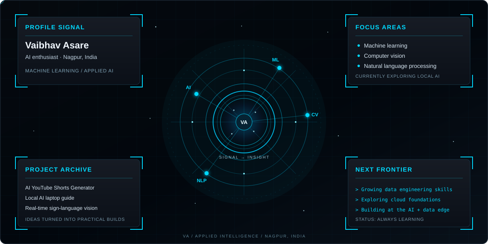

<div align="center">



<br>

[](https://www.linkedin.com/in/vaibhavasare/)
[](mailto:vbvasare@gmail.com)


</div>

---

## A little about me

I'm an AI enthusiast from Nagpur, India, interested in **machine learning, computer vision, and natural language processing**. I'm expanding that foundation into **data engineering and cloud**—and I enjoy making practical projects along the way, from real-time sign-language recognition to experiments with local AI.

```text
ml + vision + language  →  useful applications
                 next   →  stronger data & cloud foundations
```

## Things I'm exploring

- Building applied AI projects with Python and machine learning
- Computer vision and real-time recognition
- Natural language processing and local language models
- Data engineering and cloud technologies

## Selected projects

| Project | What it does |
| --- | --- |
| [AI YouTube Shorts Generator](https://github.com/VaibhavAsare/AI-Youtube-Shorts-Generator) | Finds promising moments in long videos and turns them into short-form clips, with API and local workflows. |
| [Local AI on a Laptop](https://github.com/VaibhavAsare/local-llm-laptop-guide) | A tested guide to running a small language model locally with Ollama on a CPU-only Windows laptop. |
| [Real-time Sign Language Detection](https://github.com/VaibhavAsare/Realtime-Sign-Language-Detection-And-Recognition) | A computer-vision project exploring real-time sign-language detection and recognition. |

## GitHub at a glance

<div align="center">
  
  
</div>

<div align="center">

*Curious by default. Building one useful thing at a time.*

</div>
